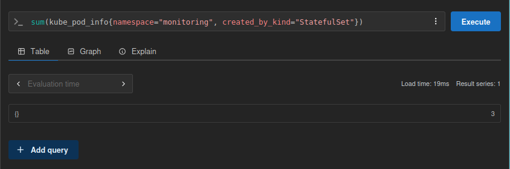

## querying with Prometheus

### actions taken
As described in the exercise, I ran:

```
kubectl -n monitoring get svc

and opened a port with:
kubectl port-forward svc/prom-prometheus-server -n monitoring 9090:80
```

### solution:

```
sum(kube_pod_info{namespace="monitoring", created_by_kind="StatefulSet"})
```



