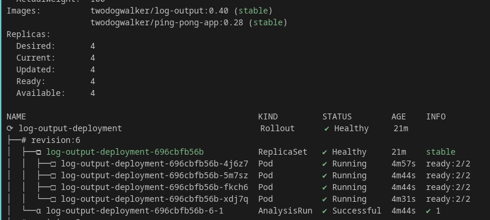

## Canary release of pingpong

### actions taken
As described in the exercise, I ran the following.
note that I changed "kubectl apply" to "kubectl create" because I ran into errors like:

CustomResourceDefinition.apiextensions.k8s.io "rollouts.argoproj.io" is invalid: metadata.annotations: Too long: may not be more than 262144 bytes¨

```
kubectl create namespace argo-rollouts

kubectl create -n argo-rollouts -f https://github.com/argoproj/argo-rollouts/releases/latest/download/install.yaml
```


### solution:



