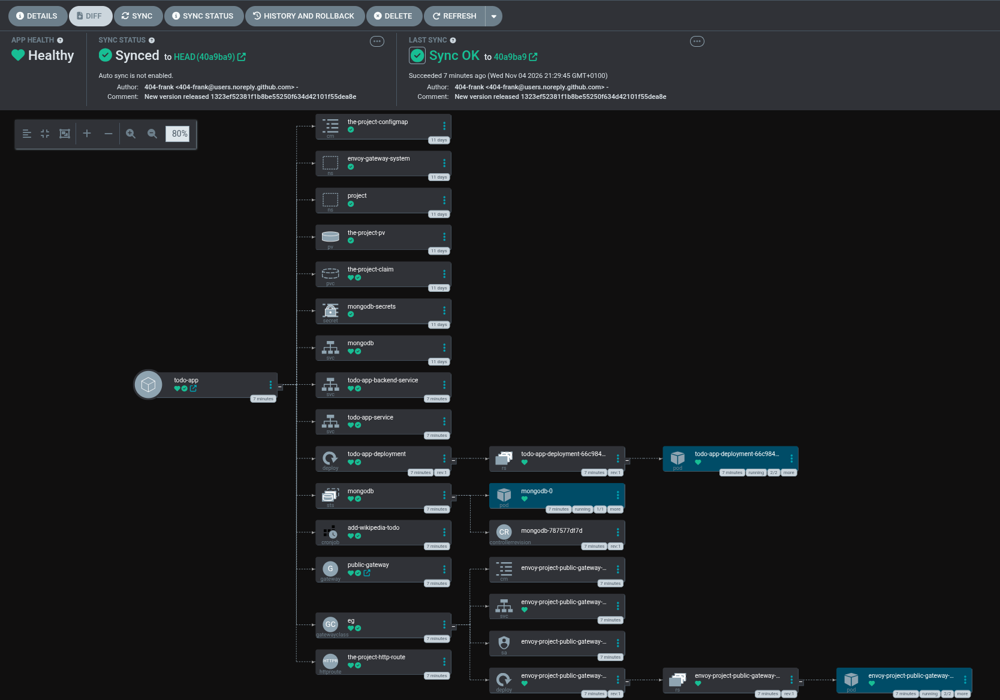

## Move log app to GitOps

### actions taken
- moved the kustomization.yaml for the log_output app
- moved the kustomization.yaml for the project app to root
- running the argoCD service
- kubectl port-forward svc/argocd-server -n argocd 8080:443
- created a new workflow on GitHub

### results:

