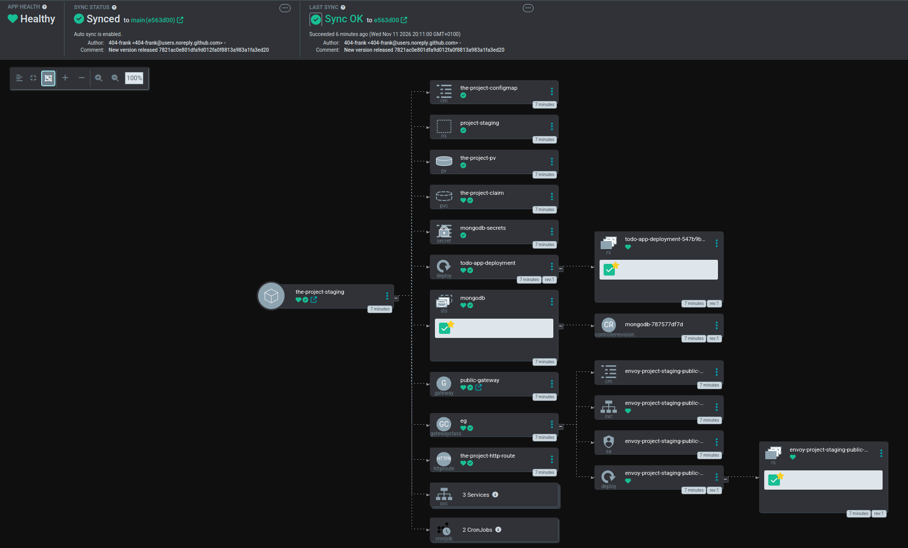
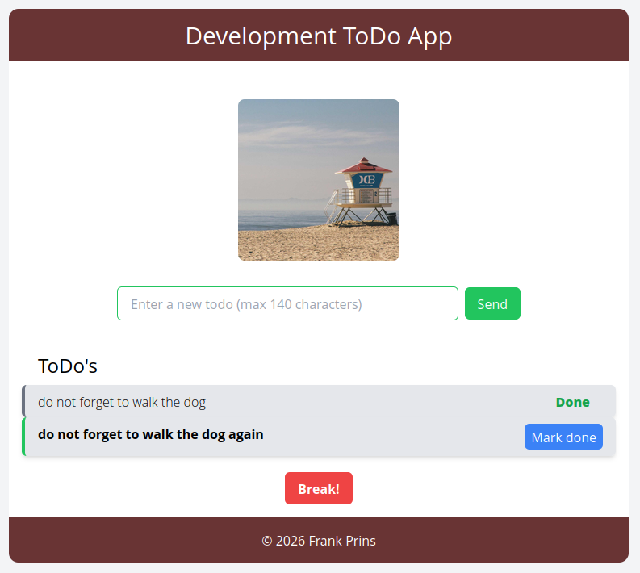

## Move log app to GitOps

#### actions taken
- moved all necessary yampl files to manifests/base
- moved the disytibute app into the main deployment
- created production and statging overlays folders
- added namespaces for each of them
- updated mongodb cronjob yaml to be able to use "suspend"
- added switch to the backend to be able not to send to an external url, just log

#### using kustomize, staging or production:
```
cd the_project
kubectl apply -k manifests/overlays/staging/
kubectl apply -k manifests/overlays/production/
```

- creating applications for staging and production

#### commands:
```
- kubectl apply -n argocd -f manifests/argocd-staging-app.yaml
- kubectl delete -n argocd -f manifests/argocd-staging-app.yaml
- kubectl apply -n argocd -f manifests/argocd-production-app.yaml
- kubectl delete -n argocd -f manifests/argocd-production-app.yaml
```
#### running the argoCD service:
```
rolled out the argocd service again:
kubectl apply -n argocd -f https://raw.githubusercontent.com/argoproj/argo-cd/stable/manifests/install.yaml
get the password:
kubectl -n argocd get secret argocd-initial-admin-secret -o jsonpath="{.data.password}" | base64 -d
kubectl port-forward svc/argocd-server -n argocd 8080:443
```
- verifying with several commits that the images are being made


#### used this for a tagged commit to verify the production environment was involved with the update:
```
git commit -m "working on exercise 4.9 #5"
git tag prod -a -m "tagging prod"
git push --atomic origin main prod
```

### results:

> ArgoCD



> The app



